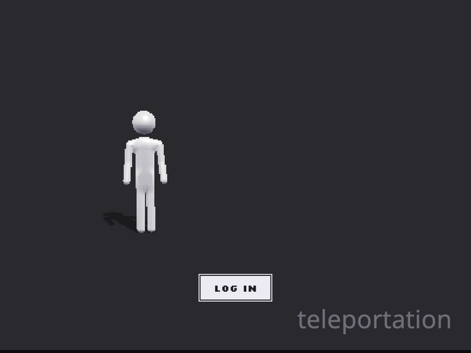

# Aero

A short three.js game about a network nobody logged out of. It renders at 400×300 and scales up with hard pixels. Play it at https://mpts.ie/games/aero/.

## Scenes

The bar under the game steps through each scene. You can also jump straight to one with `#s0` to `#s9`.

| | |
|---|---|
|  |  |
| **1. Copy.** Drag a box around the runner, pick Copy or Cut, and click to paste. The dashed box follows the selection as it moves and resizes with depth. | Copies walk together. While you carry a copy, grey ghosts preview where it will land. |
|  |  |
| **2. Title.** Hover to stir the sea of digits. | Click to drop a ripple. The centre sinks, rebounds into a peak, and throws off a blob of digits. The blob falls back in and sends out one smaller ripple. |
|  |  |
| **3. Arrival.** A glass walkway with blocks flying along its whole length and photos floating beside it. | The photos are generated, then reduced to 128 px and a 48-colour palette before the game loads them. |
|  |  |
| The path ends at a blue "We Missed You" sign. | **4. Cold open.** Text cards. |
|  |  |
| **5. Halcyon.** The cloud warden, low-poly and turning. | **7. The lake.** A found tape: square, blown out, with a pixel subtitle. |
|  |  |
| **8. Memory player.** A draggable media player window over the level. | **10. The climb.** Pillars fading into white, four memories to collect, and a pipe home. |
|  | |
| Hold **2** and steer with WASD to see where your head will be thrown; release to throw. Hold **1** to preview a roll the same way. A pink path means the head would fall. | |

## Controls

| Key | Action |
|---|---|
| WASD / arrows | Walk (Shift runs) |
| Space | Jump |
| Hold 1, release | Aim and roll your head |
| Hold 2, release | Aim and throw your head to a platform |
| Drag (Copy scene) | Select, then Copy / Cut and click to paste. Cmd/Ctrl+C and Cmd/Ctrl+X also work. |
| Drag (Climb) | Look around |

## Layout

- `public/games/aero/` is the game. Run `python3 -m http.server` in `public/` and open `/games/aero/`.
- `studio/` renders the promo and dev-log videos frame by frame from the running game. `videos/capsrv.py` receives the frames and `videos/mux.sh` adds the voiceover and music.
- `docs/` holds the screenshots above.
- `cloudflare.config.ts` and `src/index.ts` define the Cloudflare Worker that serves `public/`. Run `npm install`, then `npx cf deploy`.
