# Aero

A short three.js game about a network nobody logged out of. It renders at 400×300 and scales up with hard pixels. Play it at https://mpts.ie/games/aero/.

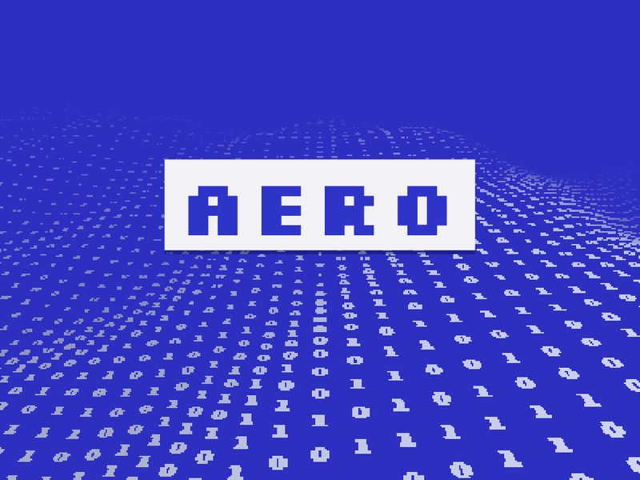

## Scenes

The bar under the game steps through each scene. You can also jump straight to one with `#s0` to `#s9`.

| | |
|---|---|
|  | 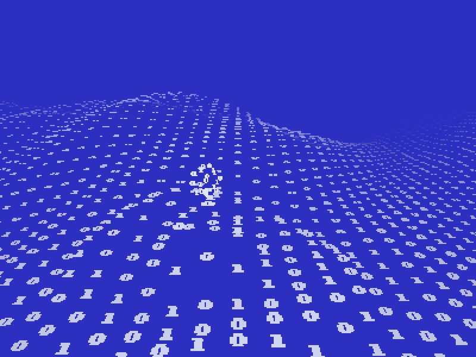 |
| **1. Title.** Hover to stir the sea of digits. | Click to drop a ripple. The centre sinks, rebounds into a peak, and throws off a blob of digits. The blob falls back in and sends out one smaller ripple. |
| 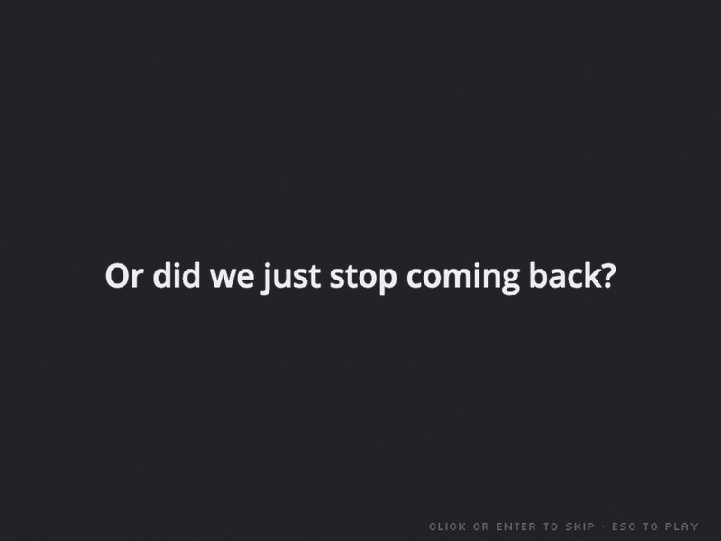 | 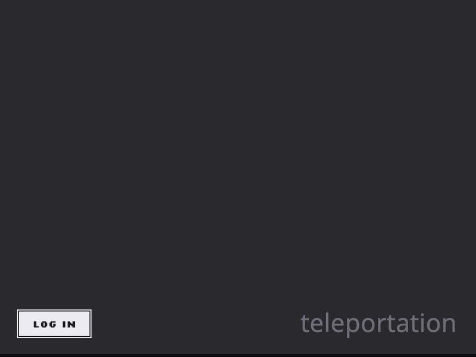 |
| **2. Cold open.** Text cards. | **3. Copy.** The room starts empty; Log in spawns the runner. Drag a box around him and pick Copy, Cut or Delete. The dashed box follows the selection as it moves and resizes with depth. |
| 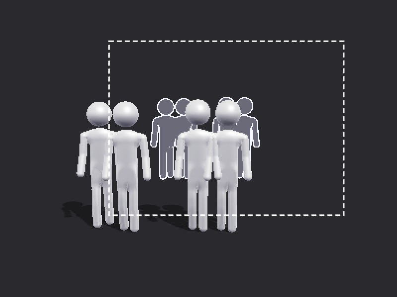 | 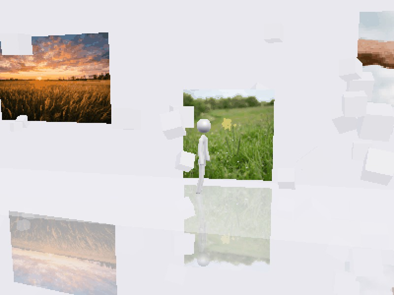 |
| Copies walk together. While you carry a copy, grey ghosts preview where it will land. Delete everyone and Log in comes back. Hold Shift while aiming heads and the crew keeps its formation. | **4. Arrival.** A glass walkway between "welcome back." and "We Missed You", with blocks flying along its whole length. |
| 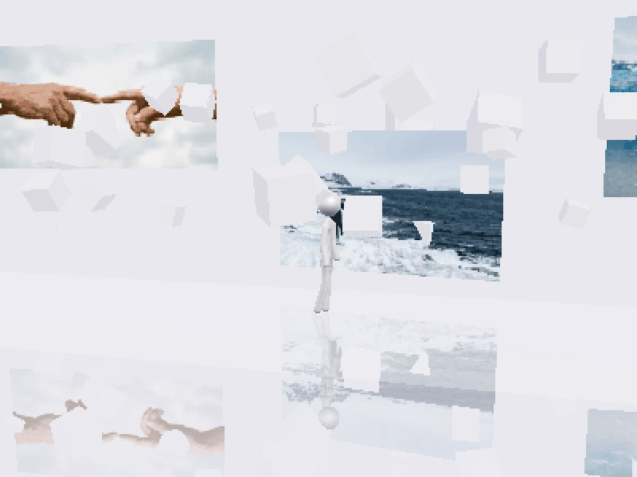 | 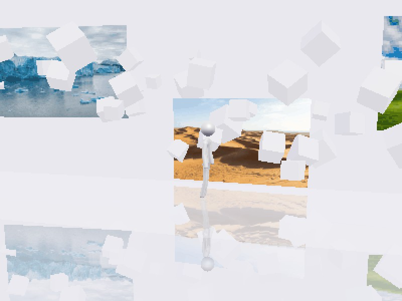 |
| Photos float beside it at different heights. They are generated, then reduced to 128 px and a 48-colour palette before the game loads them. | A blue glacier and sand dunes, |
| 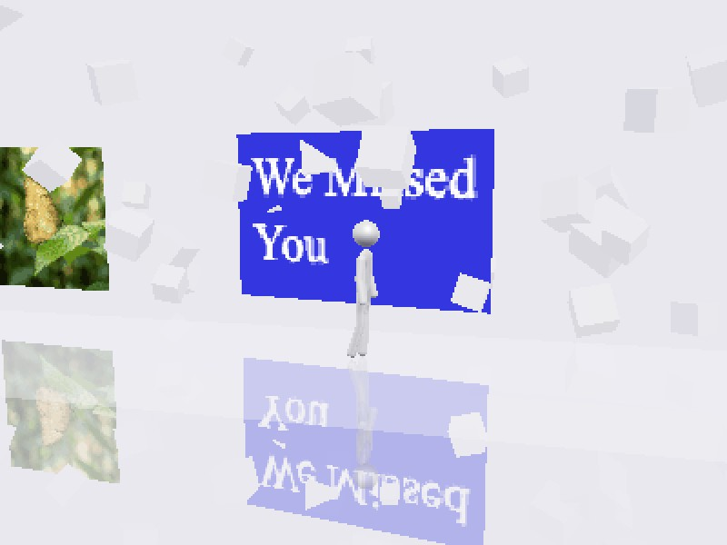 | 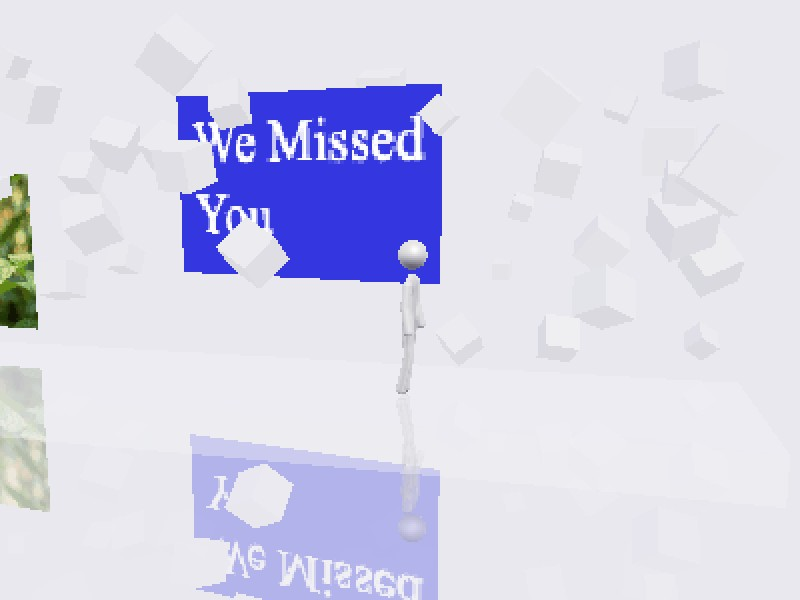 |
| a green hill and a golden butterfly. | The path ends at a blue "We Missed You" sign. |
| 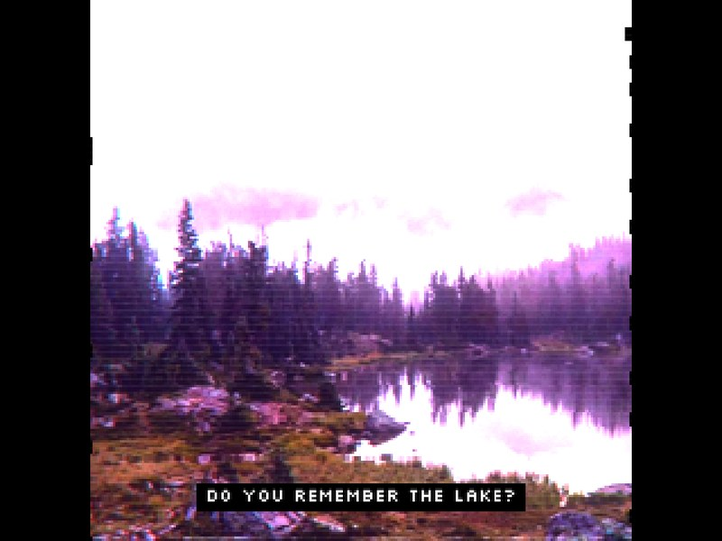 | 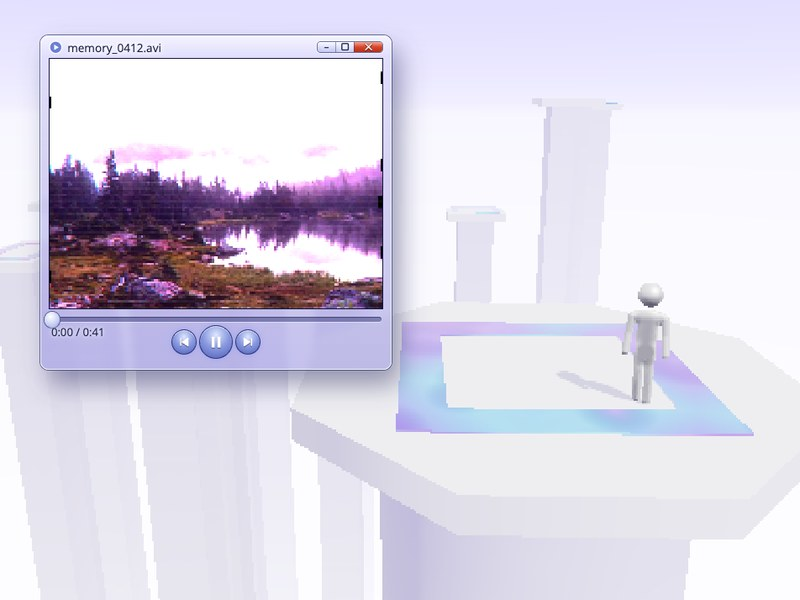 |
| **5. The lake.** A found tape: square, blown out, with a pixel subtitle. | **6. Memory player.** A draggable media player window over the level. |
| 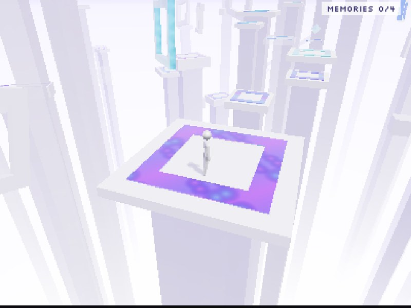 | 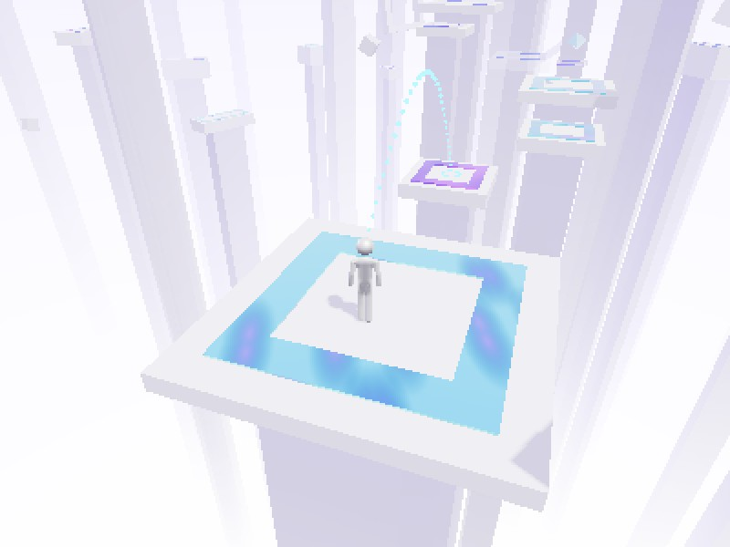 |
| **7. Go back up**, a text card, leads into **8. The climb.** Pillars fading into white, four memories to collect, and a pipe home. | Tap **2** to throw your head to the next platform. Hold 2 and move the mouse to aim at a spot, then release the key or click. The path shows as silver beads ending at a ring; pink beads mean the head would fall. |
| 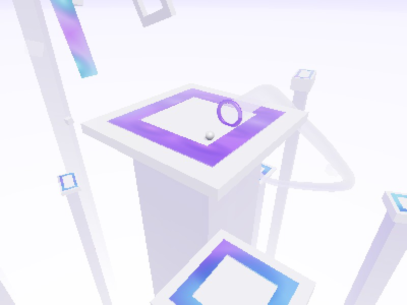 | 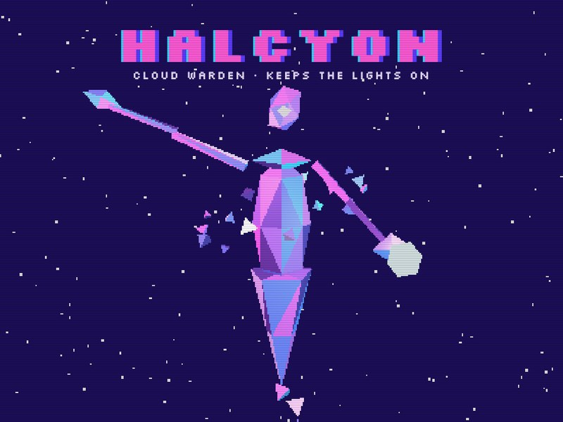 |
| The pipe lies on the top plaza. Once all four memories are found, roll your head into it with **1**. | The ride down ends the game: **9. Lights on**, a text card, then **10. Halcyon**, the cloud warden who kept the lights on. |

## Controls

| Key | Action |
|---|---|
| WASD / arrows | Walk (Shift runs) |
| Space | Jump |
| 1 | Roll your head forward |
| 2 | Throw your head to the next platform |
| Hold 1 / 2 + move the mouse | Aim at the spot under the cursor; release the key (or click) to send the head there |
| Hold 1 / 2 + WASD | Go back to aiming along your facing |
| Hold 1 / 2 + Shift (Copy scene) | Formation: the runner nearest the middle of the crew aims, and everyone else copies its direction and distance |
| Drag (Copy scene) | Select, then Copy / Cut / Delete and click to paste. Cmd/Ctrl+C, Cmd/Ctrl+X and Delete also work. |
| Drag (Climb) | Look around |

## Layout

- `public/games/aero/` is the game. Run `python3 -m http.server` in `public/` and open `/games/aero/`.
- `studio/` renders the promo and dev-log videos frame by frame from the running game. `videos/capsrv.py` receives the frames and `videos/mux.sh` adds the voiceover and music.
- The game also renders natively at other shapes: add `?shape=9x16` or `?shape=1x1` to the URL, and `&capture` to hide the controls. `studio/promo.js` scripts the vertical promos and the square site clips, `studio/capture.mjs` steps the game in headless Chrome and saves every frame (`node studio/capture.mjs v1_whole 9x16 out/`), and `studio/mux_promo.py` adds the voiceover lines and music.
- `studio/dev.html` composes the dev-log videos: two copies of the game side by side (an old build next to the current one), code panels and diagrams on one canvas. `studio/devcap.mjs` renders it frame by frame, and `studio/sitecap.mjs` records the site itself scrolling at phone size.
- The page opens on the square clips (`public/games/aero/media/`) and scrolls down through the sky to the game, which sits on the clouds at the bottom. The sky image fades in through a gradient mask over a blue sampled from its top edge, so there is no seam.
- `docs/` holds the screenshots above.
- `cloudflare.config.ts` and `src/index.ts` define the Cloudflare Worker that serves `public/`. Run `npm install`, then `npx cf deploy`.
